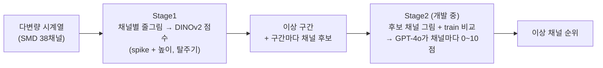
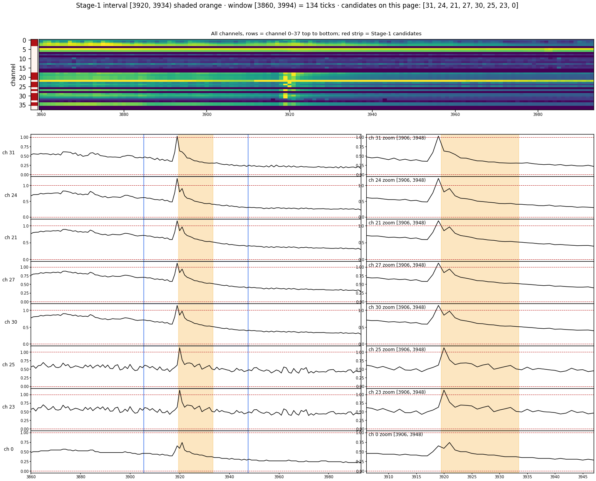

# Zero-shot 다변량 시계열 이상탐지: 그림으로 보는 이상 구간과 이상 채널

> 한양대학교 졸업프로젝트 (2026) · 팀: 김나영, 김나연

서버 모니터링처럼 채널이 많은 시계열에서 **정답 라벨 없이(zero-shot)** 두 가지를 찾습니다.
1. **언제** 이상이 일어났나 (이상 구간)
2. **어느 채널**이 이상인가 (이상 채널)

시계열을 그림으로 그려 **비전 모델(DINOv2)** 로 후보를 고르고, **VLM(GPT-4o)** 이 그림을 보고 채널을 다시 판단합니다.
원래의 [VLM4TS (AAAI 2026)](https://arxiv.org/abs/2506.06836)는 단변량용이고, 이 프로젝트는 이를 **다변량 + 채널 단위 판단**으로 넓혔습니다.

## 파이프라인

- Stage1 코드: [`VLM4TS/experiments/stage1_final/`](VLM4TS/experiments/stage1_final/)
- Stage2 코드: [`VLM4TS/experiments/stage2_link/`](VLM4TS/experiments/stage2_link/), [`VLM4TS/experiments/stage2_probe/`](VLM4TS/experiments/stage2_probe/)

### 예시: Stage2가 받는 그림

SMD machine-1-1, Stage1이 찾은 구간 [3920, 3934] (주황색).
- **위:** 38채널 전체 heatmap. 왼쪽 빨간 띠는 Stage1이 고른 채널 후보입니다.
- **아래:** 후보 채널을 원래 창(왼쪽)과 확대(오른쪽)로 그린 그림입니다. 여러 채널에서 같은 시점에 튐이 함께 보입니다.

## 진행 상황

- **Stage1 (이상 구간 + 채널 후보):** 완성. 아래 결과는 Stage1 기준입니다.
- **Stage2 (VLM 채널 판별):** 개발 중. VLM 입력 그림과 프롬프트를 단계별로 실험하고 있습니다 ([`stage2_probe/`](VLM4TS/experiments/stage2_probe/)).

## 결과 요약 (Stage1, SMD 28대)

정답 라벨 없이 고정 threshold로 잘랐을 때의 값입니다.

| 지표 | 우리 (Stage1) | 참고 (논문 값) |
|---|---|---|
| 이상 구간 event Precision / Recall | 0.392 / 0.875 | – |
| AUC-ROC | 0.874 | OracleAD 0.836 |
| VUS-PR | 0.519 | OracleAD 0.475 |
| Aff-F1 | 0.844 | OracleAD 0.847 |
| point-wise F1 | 0.356 | OracleAD 0.430 |
| HitRate@100% (채널) | 0.722 | OmniAnomaly 0.800 |

- event Precision / Recall은 [`stage1_final/`](VLM4TS/experiments/stage1_final/)의 `evaluate.py` 값입니다(후보 구간 829개). 나머지 지표는 machine마다 계산해 평균을 냈습니다.
- 논문 값은 논문에 적힌 수치입니다. OracleAD는 코드가 공개되지 않아 직접 돌리지 못했습니다.

자세한 채점 방식과 SOTA 비교: [`VLM4TS/experiments/sota_comparison/`](VLM4TS/experiments/sota_comparison/)

## 폴더 안내

| 폴더 | 내용 |
|---|---|
| [`VLM4TS/experiments/stage1_final/`](VLM4TS/experiments/stage1_final/) | **Stage1 최종 모델** (실행법·출력 형식은 폴더 README) |
| [`VLM4TS/experiments/stage2_link/`](VLM4TS/experiments/stage2_link/) | Stage1 → Stage2 연결, VLM 채널 판정 (개발 중) |
| [`VLM4TS/experiments/stage2_probe/`](VLM4TS/experiments/stage2_probe/) | GT 채널 특징 분석, VLM 입력 그림·프롬프트 단계별 실험 (개발 중) |
| [`VLM4TS/experiments/sota_comparison/`](VLM4TS/experiments/sota_comparison/) | SOTA와 같은 지표로 채점 (SMD 28 / ASD 12) |
| [`VLM4TS/sanity/`](VLM4TS/sanity/) | 초기 검증: GPT-4o가 그림에서 채널 관계를 읽을 수 있는가 (가짜 데이터) |
| `VLM4TS/experiments/` 의 주차별 폴더 | 탐색 단계 실험 기록 (20주차, 24~26주차, 10월 분석) |

## 팀

김나영, 김나연 두 명이 전 과정을 함께 진행했습니다.
매주 실험 결과를 함께 검토하며 서로 피드백하고, 부족한 부분을 보완해 나갔습니다.

## 데이터

- SMD (Server Machine Dataset, OmniAnomaly KDD 2019), ASD (InterFusion KDD 2021)
